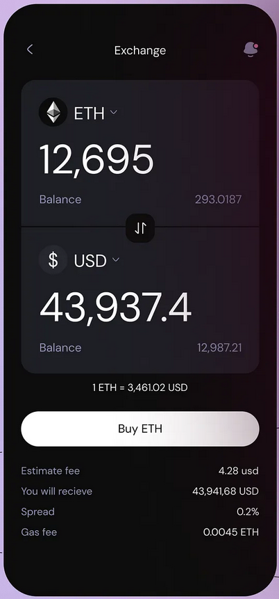

# Crypto Exchange UI Challenge

A responsive cryptocurrency exchange interface built with React Native and Expo. The application recreates an exchange screen with a dark purple theme, currency selection, interactive controls and transaction information.

## Preview



## Features

- **Exchange interface:** Displays ETH and USD currency panels.
- **Currency selection:** Choose between ETH, USD and BTC.
- **Currency swapping:** Switch the selected currencies.
- **Interactive dropdowns:** Open and close currency selection menus.
- **Buy ETH button:** Includes hover and press visual feedback.
- **Notifications:** Interactive notification bell with a sample notification panel.
- **Exchange rate:** Displays the exchange rate between ETH and USD.
- **Transaction details:** Shows estimated fees, amount to receive, spread and gas fee.
- **Responsive layout:** Adapts to mobile, tablet and desktop screen sizes.
- **Dark appearance:** Uses a dark background with purple gradient styling.

## Technologies Used

- React Native
- Expo
- TypeScript
- React
- React Native SVG
- Expo Linear Gradient
- React Native Vector Icons
- Hugeicons

## Getting Started

### Prerequisites

Make sure you have the following installed:

- Node.js
- npm
- Git
- Expo-compatible development environment

### Installation

1. Clone the repository:

   ```bash
   git clone https://github.com/Sharon-Mashai/React-Native-UI-Challenge.git
   ```

2. Navigate into the project directory:

   ```bash
   cd React-Native-UI-Challenge
   ```

3. Install dependencies:

   ```bash
   npm install
   ```

4. Start the Expo development server:

   ```bash
   npx expo start
   ```

### Running the Application

After starting Expo, choose the platform you want to use:

- Press `w` to open the web version.
- Scan the QR code using Expo Go to run it on a compatible mobile device.
- Use an Android emulator if one is configured.

## Android APK Download

The Android application build is available on Google Drive:

[Download Crypto Exchange UI Challenge APK](https://drive.google.com/drive/folders/10bg2zpd-8ksvk0tKIDDmk8ucCQevh06h?usp=sharing)

## TypeScript Check

To check the project for TypeScript errors, run:

```bash
npx tsc --noEmit
```

## Author

Developed as part of a React Native UI Challenge.
